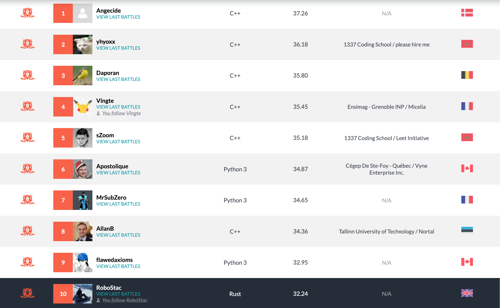

# Ultimate Tic-Tac-Toe bot

A bot for the [CodinGame Ultimate Tic-Tac-Toe arena](https://www.codingame.com/multiplayer/bot-programming/tic-tac-toe),
in one C++ file: bitboard engine, Monte Carlo tree search with a solver, an NNUE-style value net and an
opening book built from arena games.

Started at rank 195 in Legend (score 20.23) with an older MCTS bot (`league/src/legacy.cpp`, the first
baseline). Current: v1.27, **36.18, rank 2 / ~490 Legend** (2026-11-16). Per-version results and every
measurement: [docs/history.md](docs/history.md).



### Path so far

| Stage | Score | Rank |
|---|---|---|
| legacy bot | 20.23 | 195 |
| v1.0–v1.3: MCTS-Solver + value net + PUCT | 23.8 → 31.4 | 63 → 13 |
| v1.4–v1.7: bigger nets, threat inputs, pondering | 31.4 → 32.2 | 11 |
| v1.8–v1.15: opening book from our lost arena games (long offline searches, record / refuted / pre-emptive entries) | 32.8 → 34.5 | 10 → 4 |
| v1.22–v1.27: book refresh after the opponents resubmit (only positions the live version lost every game in) | 33.3 → 36.18 | 8 → 2 |

Engine and net are unchanged since v1.7 (n7t); every gain since then is the book. Self-play gains of the
search parameters, contempt and deeper nets did not carry over (see Measurements in the history).

## How the bot works

- **Search**: expand-all MCTS ("UBFM"-like): a leaf expands every child and scores each with the net;
  PUCT selection with priors = softmax(child values / 0.1), c = 1.0, 4 virtual visits per first value;
  MCTS-Solver (proven win / loss / draw); final move = value + 0.02·ln(visits); tree reuse; pondering
  during the opponent's turn (and, as second player, before the opponent's first move).
- **Net**: (189 + 18 small-board threat inputs) → 640 ×2 perspectives → 10 output buckets, int16 AVX2,
  incremental accumulators with a cache in high-visit nodes. Trained on self-play of earlier nets
  (`tools/train.py`), Huffman-coded into the source (~95k chars).
- **Book**: positions of our non-won arena games searched 4M–16M iterations offline; where the long
  search prefers another move, the book answers (position hash → move). Arena opponents are close to
  deterministic, so the same lost games repeat and the book changes them.

## Quick start

```sh
make            # build/bot (local build) and build/referee
make perft      # engine vs referee move counts: 81 720 6336 55080 473256 4020960 33782544 281067408
python3 tools/pack.py -n tools/nets/n7t640.bin -H 640 --huff --book tools/book.txt -o out/sub.cpp bot.cpp
modal run tools/modal_match.py --a out/new.cpp --b out/old.cpp --games 600 --iters 30000 --pa PONDER=0 --pb PONDER=0
python3 tools/cg.py submit out/sub.cpp        # arena submit + IDE mirror
```

## Layout

| Path | What |
|---|---|
| `bot.cpp` | Engine, search, net, book, protocol; local tools under `#ifdef LOCAL` (perft, bench, self-play generation `UT_GEN`, analysis `UT_ANALYZE`, fixed iterations, profiler `UT_PROF`) |
| `tools/referee.cpp` | Native referee, written independently of the engine (cross-checked by perft) |
| `tools/pack.py` | Single-file submission: embeds the net (Huffman-coded int8) and the book, strips local code |
| `tools/train.py` | Value-net trainer (PyTorch): buckets, threat inputs, dedup, fine-tuning (`--init`), distillation options |
| `tools/modal_gen.py`, `tools/kaggle_gen.py` | Self-play data generation on Modal containers / Kaggle CPU kernels (two accounts) |
| `tools/modal_train.py`, `tools/kaggle_train.py` | Training on a Modal A10G / Kaggle GPU |
| `tools/modal_match.py`, `tools/kaggle_match.py`, `tools/league.py` | Gate matches (fixed iterations or real time) with Elo ± 95% |
| `tools/cg.py` | CodinGame API: test games (incl. replays of arena battles), submit + IDE mirror, progress, leaderboard |
| `tools/arena.py` | Downloads our arena battles and game logs (`arena/battles.jsonl`, `arena/games.jsonl`), stats by opponent |
| `tools/cg_suite.py` | Replays a suite of our lost battles against the opponents' current code (test games) |
| `tools/book.py`, `tools/modal_book.py`, `tools/kaggle_book.py` | Opening book: positions of non-won games → long searches on Modal / Kaggle → `tools/book.txt` |
| `tools/modal_pre.py` | Pre-emptive book: the opponent's likely replies to book moves, answered before the arena reaches them |
| `tools/refresh.py`, `tools/refresh_loop.sh`, `tools/book_guard.py` | Safe book refresh against the opponents' current code; guard against changing frequent well-scoring lines |
| `tools/probe.py`, `tools/losses.py` | Probing alternatives in replays of lost battles; loss report (our errors vs opponent surprises) |
| `tools/nets/` | Trained nets (`.bin` for the engine, `.pt` for fine-tuning) |
| `versions/` | Every submitted source |
| `docs/history.md` | Versions, gates, arena results, all measurements (positive and negative) |
| `docs/research.md` | What the strong bots do: forum, post-mortems, papers |
| `docs/statement.md` | The rules |

## Book workflow

```sh
python3 tools/arena.py fetch --logs SUB                       # games of submission SUB
python3 tools/book.py positions SUB1 SUB2 --logs              # our positions in non-won games (+ test logs)
modal run tools/modal_book.py --src out/c24_n8t.cpp --iters 4000000 --chunk 24          # new positions
modal run tools/modal_book.py --src out/c24_n8t.cpp --iters 16000000 --chunk 24 \
    --min-games 3 --out book_an_deep.jsonl                    # frequent positions, preferred by build
python3 tools/book.py build --gain 0.0 --draw-gain 0.02       # -> tools/book.txt
python3 tools/cg_suite.py lost 25 SUB && python3 tools/cg_suite.py run out/sub.cpp LABEL   # replay lost battles
```

### Refresh loop (current method)

The top bots resubmit daily, which makes book lines stale (v1.15: 34.49 → 33.28 overnight). Each cycle
(`tools/refresh_loop.sh N`, ~45 min, state in `$SC`): wait for the placement, fetch its games, analyse the
new positions on Kaggle (both accounts, `tools/kaggle_book.py`), rebuild the book, keep only entries at
positions where the live version lost every game (`tools/refresh.py`), check `tools/book_guard.py`
(no change to frequent well-scoring lines), pack, submit; resubmit the previous version if the new one
places more than 0.2 below it.

```sh
python3 tools/refresh.py SUB --base BOOK_OF_SUB --out /tmp/next_book.txt
python3 tools/book_guard.py --book /tmp/next_book.txt --base BOOK_OF_SUB
SC=/path/to/state tools/refresh_loop.sh 12
```

Things that did not work: entries from one or two probe test games (`tools/probe.py`): wins and draws
against the top bots do not replay (4 / 4 lost on re-test), and one such entry at ply 1 cost 2 points
(v1.18).

The analysis source must embed its net and keep the `LOCAL` blocks (`pack.py --keep-local`). Positions
that occur in a won game, or in a second-player draw, are never changed. Test-game logs count as games,
so replaying lost battles and rebuilding repeats the cycle without waiting for the arena.
